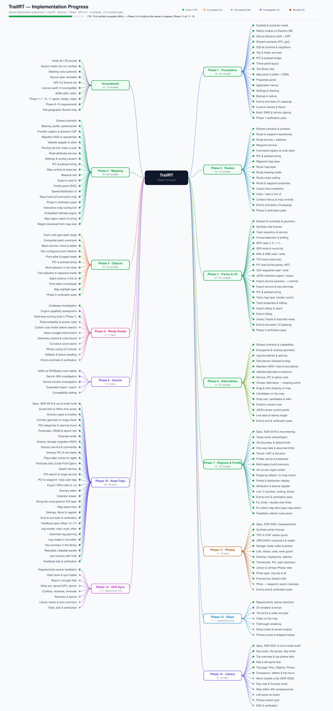

# TrailRT

A modern desktop replacement for Garmin BaseCamp. Local-first, macOS, built on
Electron with React and TypeScript. Plan, organise, view and edit outdoor trips,
routes, tracks and waypoints, with OpenStreetMap and OpenTopoMap as map
providers and no Garmin hardware or cloud account required.

**Status: Phases 1 to 4 complete and verified.** The app launches, renders an
OpenStreetMap or OpenTopoMap map, and manages trips, folders, routes, tracks and
waypoints that persist across restarts. Routes are drawn and edited directly on
the map with undo and redo over every edit; GPX, KML, KMZ, TCX, FIT and CSV
import and export; and the map now carries a scale bar, cursor coordinates,
layer visibility, a measure tool, a combined elevation and road-attribute
profile, and snap-to-road backed by a routing engine built into the app. Phase 5
(windy-roads routing) is next.

Every acceptance criterion is verified against the packaged DMG build, not just
the development output: 812 unit tests and 68 end-to-end tests pass, with a
clean typecheck and no lint errors.

### What road routing is, and is not

There are two ways to get a road-following route. The **snap routing tool** in
the map toolbar routes as you go: each click is a control point and the road
geometry between it and the last one appears immediately, so you build the route
and watch it follow the roads. Alternatively, draw a straight-line route and
press **Snap to roads** in its properties to convert it in one step. Either way
your clicks are kept as control points, so the route can be re-snapped later in
a different transport mode without redrawing it.

Snap-to-road, road classes and posted speed limits need an external routing
service, and **none is configured by default**. With no endpoint set, TrailRT
makes no network requests beyond map tiles, routes stay as the straight lines
you draw, and nothing in the UI claims otherwise. Point it at a Valhalla
instance — your own or one you are permitted to use — and the features become
available after you accept a consent prompt that names the host.

### Road routing is built in

The Valhalla routing engine is **embedded in the app**. There is no server to
install, no endpoint to configure, no account, and no network request — and
therefore no consent prompt, because nothing leaves your machine.

It runs in-process as an N-API addon, so there is no daemon, no port and no
background process. Measured inside Electron against a local graph: a route in
52 ms, road attributes across 51 edges in 7 ms.

What you do need is a **region**, because the engine is useless without a
routing graph. Pan the map to where you want to route and press **Add a map
region**: TrailRT matches the visible area against Geofabrik's published
extracts and offers the few that cover it, most specific first, with real
download sizes. Pick one and it downloads and builds a graph locally.

Sizes matter, which is why they are shown before you commit. Zoomed in on
Liechtenstein the options are the country at 3.3 MB, or the Alps bundle that
covers your whole view at 2.3 GB. Anything past 2 GB is marked unselectable
rather than allowed to start a download that would be refused at the end.

Importing a `.osm.pbf` by hand still works, for a custom extract or a region
Geofabrik does not publish.

Building the app therefore has one extra prerequisite:

```sh
npm run build:valhalla   # compiles Valhalla 3.9.1 (~7 min, needs Homebrew)
npm run verify:valhalla  # proves it loads in Electron and returns speed limits
```

Neither is part of `npm run verify`, so day-to-day development is unaffected.

An external Valhalla server is still supported for anyone who already runs one —
set the endpoint in Settings and it is used instead. `npm run
verify:valhalla:remote` exercises that path against the public demo instance.

Two limits stated plainly:

- **Apple silicon only.** The engine is compiled from source, and an x64 build
  would mean a second toolchain under Rosetta and a second compile every
  release. Intel Macs are not supported, and the app declares that rather than
  failing to launch. macOS **13.3** or later, because Valhalla's use of libc++
  `<format>` needs `std::to_chars`. See ADR 0013.
- Posted speed limits come from OpenStreetMap, where `maxspeed` coverage is
  partial. Distance with no known limit is reported as a sized **Unknown** band
  and is never redistributed across the known bands or inferred from road
  class. On minor roads that band is often the largest, and that is the correct
  answer. See [ADR 0011](docs/adr/0011-speed-data-sources-and-snapping.md).

```sh
nvm use          # Node 26
npm install
npm run dev      # development, with HMR
npm run verify   # lint, typecheck, unit tests, build, end-to-end tests
npm run package  # macOS .app + DMG for arm64 and x64
```



## Where things are

| Path                                                     | Contents                                                           |
| -------------------------------------------------------- | ------------------------------------------------------------------ |
| [`.kiro/specs/`](.kiro/specs/)                           | Phase specs, and the review of the source specification            |
| [`.kiro/steering/`](.kiro/steering/)                     | Always-applied rules: toolchain, architecture, licensing, progress |
| [`docs/adr/`](docs/adr/)                                 | Architectural decision records                                     |
| [`docs/licences/`](docs/licences/)                       | Third-party dependency and licence register                        |
| [`docs/progress-mindmap.svg`](docs/progress-mindmap.svg) | Canonical implementation status                                    |

Read [`.kiro/specs/spec-review.md`](.kiro/specs/spec-review.md) first. It
records the contradictions found in the source specification and how each was
resolved, plus the two open questions that still need an owner decision.

## Toolchain

Node 26 LTS, pinned in `.nvmrc`. Run `nvm use` before any npm command. The
verified version matrix for the whole stack lives in
[`.kiro/steering/toolchain.md`](.kiro/steering/toolchain.md); every entry was
resolved against the registry and dry-run installed together, so it is a known
good set rather than an aspiration.

## Development phases

1. **Foundation** — _complete._ Electron shell, security baseline, SQLite with
   migrations, three-panel layout, trip library, OpenStreetMap view, menus,
   settings, backup and restore
2. **Routes and waypoints** — _complete._ Draw routes on the map, drag/insert/
   delete vertices, waypoints with a Garmin-aligned symbol set, derived
   statistics, and an undo history over every edit
3. **Tracks and import/export** — _complete._ Recorded tracks with a simplified
   render cache for large files, import with a preview-then-commit pipeline, and
   an import report that never silently discards data
4. **Advanced mapping** — _complete._ OpenTopoMap and user-supplied tile
   sources, overlays, a provider-agnostic routing abstraction with an
   embedded Valhalla engine (ADR 0013) and an HTTP adapter for a remote one, an interactive snap routing tool plus one-step snapping of an
   existing route, both keeping your points as control points, a combined
   elevation / speed / road-class profile, distance-weighted speed
   distribution, scale bar, cursor coordinates, layer visibility, keyboard
   panning, a measure tool and the Waze hand-off
5. **Windy roads routing** — motorcycle-friendly routes that favour bends, with
   curvature scoring that steers the search rather than re-ranking afterwards
6. **Garmin compatibility** — GDB, IMG and device transfer investigations

Phases are built in order. Later phases are specified at requirements level only
until the phase before them is built and tested.

## File formats

Only formats with tests against real fixtures are listed. Nothing here is a
claim of support that has not been exercised.

| Format                    | Read | Write | Notes                                                                                                                          |
| ------------------------- | ---- | ----- | ------------------------------------------------------------------------------------------------------------------------------ |
| GPX 1.0 / 1.1             | ✓    | ✓     | Waypoints, routes and multi-segment tracks. Round-trips exactly, including absent values                                       |
| KML                       | ✓    | ✓     | `Placemark` Point and LineString, `MultiGeometry`, `gx:Track` with timestamps, `ExtendedData`                                  |
| KMZ                       | ✓    | ✓     | The KML document inside the archive. Other archive contents are reported, not silently ignored                                 |
| TCX                       | ✓    | —     | Activity trackpoints become tracks; laps become segments. Heart rate and cadence are preserved as metadata                     |
| FIT                       | ✓    | —     | Via the MIT-licensed parser, not Garmin's SDK (ADR 0006/0007). Coordinates are quantised by the format, and the import says so |
| CSV                       | ✓    | ✓     | Waypoints, with header mapping and delimiter detection for spreadsheets from elsewhere                                         |
| TrailRT collection (JSON) | ✓    | ✓     | Whole trips, folders and geometry, for moving between installs. Imports as a merge, never an overwrite                         |
| Garmin GDB                | —    | —     | Recognised and explained rather than accepted and failed. Phase 6                                                              |
| Garmin IMG                | —    | —     | Map products rather than trip data. Phase 6                                                                                    |

**TCX and FIT are deliberately read-only.** Both describe a recording session —
laps, device identity, sport — that TrailRT does not hold, so writing one would
mean inventing that data. A file claiming to be a Garmin activity and not being
one is worse than the absence of the option. Export as GPX instead.

Nothing in TrailRT circumvents encryption, DRM or map licensing.

## Licence

**GPL-3.0-or-later.** See [`LICENSE`](LICENSE).

TrailRT is free to download and use. No subscriptions, no mandatory accounts, no
advertising, no paid feature tiers, and no cloud dependency for core
functionality. It is meant to be a community-friendly alternative to BaseCamp,
and the licence is chosen to keep it that way.

Every dependency is audited for GPL-3.0 compatibility before it is added, and
the results are recorded in
[`docs/licences/third-party-register.md`](docs/licences/third-party-register.md).
The current audit covers 369 packages with no incompatibilities. Two packages
were excluded on licence grounds: `react-leaflet` (Hippocratic-2.1, so Leaflet
is used directly) and Garmin's own `@garmin/fitsdk` (proprietary EULA, so the
MIT-licensed FIT parser is used instead).

Distribution is via GitHub releases and a DMG. The Mac App Store is not a
target — its terms conflict with GPL-3.0.

## Installing a release build

There is no Apple Developer ID for this project yet, so release builds are
ad-hoc signed rather than notarised. macOS will block the app on first launch
with a message about being unable to check it for malicious software.

To open it:

1. Try to open TrailRT once, so macOS records the block.
2. Open **System Settings → Privacy & Security**, scroll to the Security
   section, find the line naming TrailRT, and click **Open Anyway**.
3. Authenticate. The app opens normally from then on.

The old Control-click → Open shortcut no longer works; macOS removed it in
Sequoia. Do not disable Gatekeeper system-wide to work around this — that trades
your whole machine's protection for one app.

Building from source avoids the prompt entirely, since locally built bundles are
not quarantined. Notarisation is already configured in the build and will be
switched on if a Developer ID becomes available. See
[ADR 0009](docs/adr/0009-unsigned-distribution-until-developer-id.md).

## Known limitations

Recorded up front rather than discovered later:

- **GDB** has no JavaScript parser. GPSBabel is the only mature reader, and
  because it is GPL-2.0-or-later it is compatible with our licence, so support
  is viable — but it is Phase 6 work and unproven until tested against real
  files. See ADR 0006 as amended.
- **Garmin IMG** rendering is architecturally accommodated but not planned for
  implementation. No encryption or licensing circumvention, ever.
- **Waze** accepts a single destination per link, so route hand-off resolves to
  the end point, and the button says "end point" so nobody expects more.
  Multi-stop is not supported by the platform, so no control for it exists — see
  ADR 0005.
- **Elevation** is shown only where the source data carries it. Nothing is
  synthesised, and absent values display as unavailable rather than zero.
- **Tile usage** follows the OpenStreetMap policy: no prefetching, no bulk or
  area downloads. Offline maps are available today as a user-supplied local tile
  source, configured in Settings.
- **Road routing needs a map region.** The engine is embedded, but it cannot
  route until you give it an OpenStreetMap extract to build a graph from. That
  is a one-off per region.
- **Apple silicon only, macOS 13.3+.** See ADR 0013 for why, including the
  `std::to_chars` constraint that sets the floor.
- **Snapping moves routes, never tracks.** A recording is measured data, so a
  track's samples are never relocated onto a road. A track can still be
  map-matched to _read_ road attributes, which leaves every sample where it is.
  See ADR 0011 §4.
- **No third-party overlay service** ships. The overlay mechanism works and is
  exercised by the user-supplied overlay; adopting someone else's tile service
  means accepting their usage policy, and that review has not been done.
