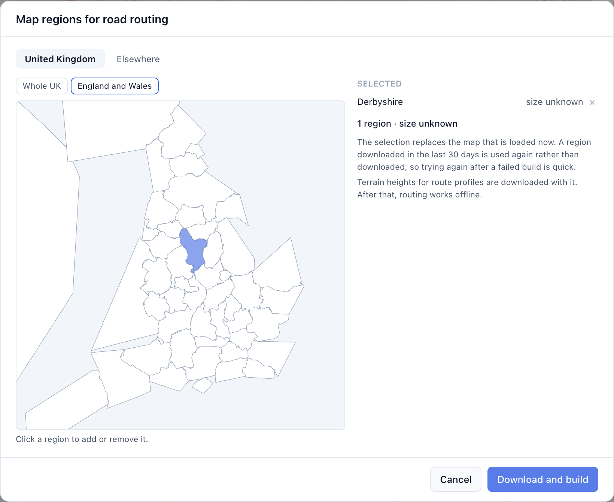
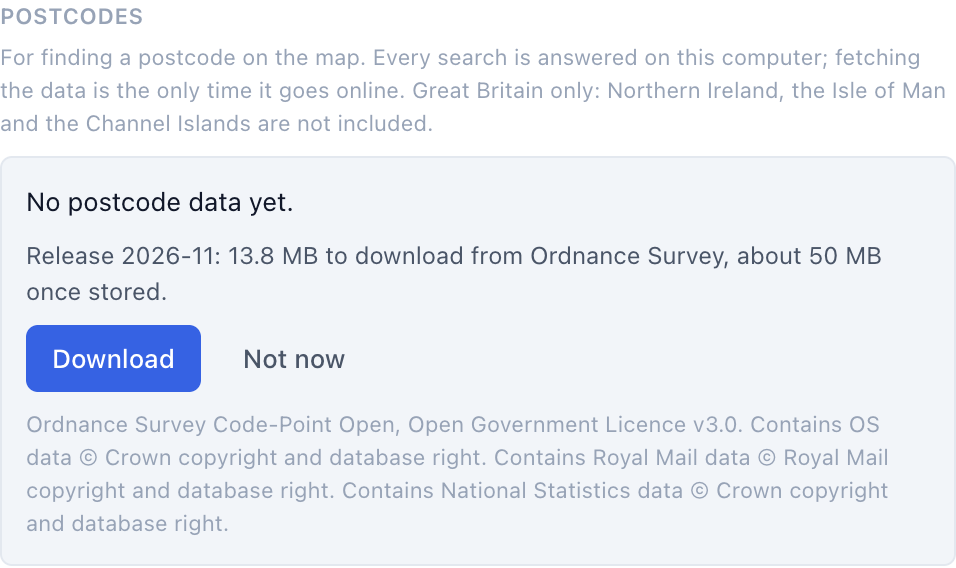

# First-time setup

TrailRT needs an internet connection for these one-time downloads. Download
road-routing map data first, then postcode data.

## 1. Download road map data

1. Open **Settings** and find **Map regions**.
2. Select **Choose map regions…**.
3. On the **United Kingdom** map, select the counties you need. Select more
   than one if your routes cross county borders. For somewhere outside the UK,
   use the **Elsewhere** tab.
4. Select **Download and build** and wait for the map to finish building.

This downloads the road data used for routing, plus terrain heights for route
profiles. It is not a download of the visible street-map background. Once
built, road routing works offline for the selected regions.



## 2. Download postcode data

1. Open **Settings** and scroll to **Postcodes**.
2. Select **Get postcode data…**. TrailRT checks Ordnance Survey for the
   available release and shows its download size.
3. Select **Download** and wait for the data to finish installing.

Postcode searches then run on this computer without an internet connection.
The dataset covers Great Britain; it does not include Northern Ireland, the
Isle of Man or the Channel Islands. The release and download size shown below
may change.



# Move Out of Quarantine

Until I get my MacOS notarization, you will need to remove the quarantine attribute from the app bundle after downloading it. You can do this by running the following command in your terminal:

```
xattr -dr com.apple.quarantine "/Applications/TrailRT.app"
```
